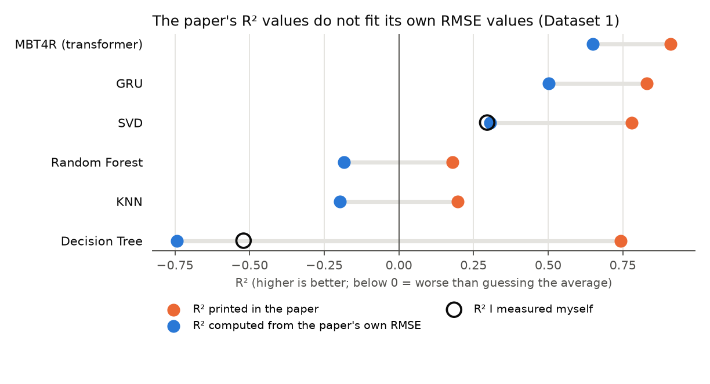

# Reproducing a 2025 recommender benchmark on MovieLens

SVD, KNN and the six co-clustering bases of Banerjee et al. (2007), evaluated on three MovieLens datasets under five train/test protocols, with every test set fingerprinted.


This repository re-runs the baselines of Khan et al. (2025), *A transformer-based architecture for collaborative filtering modeling in personalized recommender systems* (Scientific Reports 15, 24503), and extends the comparison to co-clustering. It contains all code, all raw results (more than 6,000 runs) and all figures.

**Author:** Elif Hüsna Turkay · Independent study supervised by Dr. Hyuk Cho, Department of Computer Science, Sam Houston State University

## Key findings

- On **MovieLens latest-small**, the paper's SVD result reproduces exactly: RMSE 0.870 and MAE 0.667 (reported 0.87 and 0.67).
- On **MovieLens 20M** it does not. Every protocol gives RMSE between 0.78 and 0.88; the paper reports 0.91.
- The paper's **R² values contradict its own RMSE values**. On a fixed test set, R² = 1 − MSE / Var(y), so a higher RMSE must give a lower R². Our measured R² matches the value implied by the paper's RMSE.
- The paper's "SVD" behaves like **Funk SVD** (Surprise `SVD`), not truncated SVD. K = 5 is not the best K on any dataset.
- Among the six co-clustering bases, the winner depends on **training ratings per learned parameter**. MSSRCC (C6) is best on 20M at 2 × 2 and 3 × 3 and overfits on the small datasets (2.6 ratings per parameter on latest-small).
- On the small datasets, an **item-based KNN** beats every SVD and co-clustering setup under random splits, but loses to Funk SVD on temporal splits.

| | Best co-clustering | Best Funk SVD | Item-based KNN |
|---|---|---|---|
| latest-small (5-fold) | C3, 10 × 5: 0.885 | 0.875 | **0.853** |
| ml-100k (5-fold) | C4, 50 × 2: 0.941 | 0.930 | **0.916** |
| ml-20m (random 80/20) | C4, 50 × 50: 0.837 | **0.786** | not run |


## What we did

1. **Matched the paper's data.** The paper uses MovieLens latest-small (Dataset 1) and MovieLens 20M (Dataset 2). We used both, with MovieLens 100k as a third dataset, and checked the rating, user and movie counts against the paper.
2. **Fixed the splits.** The paper describes its split three different ways and gives no seed, so every model was run under five protocols: random 80/20, per-user temporal 80/20, 5-fold CV, leave-last-one-out and leave-random-one-out. All scripts take their split from one module and record a fingerprint of the test set, so any two numbers in this repository can be checked for being measured on the same ratings.
3. **Re-ran the paper's baselines.** SVD (library defaults, as the paper gives no settings) and the Decision Tree with the paper's input features. We also wrote Funk SVD ourselves and confirmed that it matches the Surprise library to 1e-15.
4. **Checked the paper's tables against themselves.** The paper reports both RMSE and R² for XGBoost, which fixes the variance of its test set. From that, the R² implied by every other RMSE in the table follows directly (`code/r2_check.py`).
5. **Swept the number of factors.** Truncated SVD and Funk SVD for K = 0 to 100 on all three datasets, then both SVDs on all protocols and Funk SVD with different regularization, epochs and learning rates.
6. **Compared six co-clustering bases.** All six bases of Banerjee et al. (2007) in one implementation, checked against their matrix forms, each on a 9 × 9 grid of user and item cluster counts from 1 to 50 (5-fold CV on the small datasets, K = L on 20M), and each basis at its best size on all protocols.
7. **Added KNN.** The paper lists KNN as a baseline but does not describe it. We used an item-based KNN with a baseline estimator on the two small datasets.

## Repository layout

```
code/
  common_split.py    datasets, the five split protocols, test-set fingerprint
  own_models.py      Funk SVD (matches surprise.SVD to 1e-15) and sparse co-clustering
  bases.py           the six co-clustering bases C1..C6 in one class
  eval_protocols.py  one dataset x one model x one protocol -> results/eval.jsonl
  run_protocols.py   runs every model and protocol, prints the tables
  k_sweep.py         truncated SVD and Funk SVD for K = 0..100
  svd_full.py        both SVDs on all protocols; Funk SVD hyperparameters
  run_bases.py       six bases: 3 x 3 on all protocols, K x L grid, best cells
  plot_k.py, plot_svd_full.py, plot_bases.py   figures and tables
  r2_check.py        R2 implied by the paper's own RMSE values (no data needed)
scripts/
  download_data.py   fetches the datasets from GroupLens
results/
  *.jsonl            one JSON line per run (dataset, model, protocol, fold, RMSE, MAE, R², fingerprint)
  figures/           all figures
```

## Reproducing the results

```bash
pip install -r requirements.txt
python3 scripts/download_data.py          # add --20m for MovieLens 20M (about 190 MB)
cd code

python3 run_protocols.py mlsmall          # SVD, Decision Tree, KNN, co-clustering, 5 protocols (minutes)
python3 k_sweep.py mlsmall tsvd kfold     # truncated SVD, K = 0..100 (seconds)
python3 k_sweep.py mlsmall funk kfold     # Funk SVD, K = 0..100 (about a minute)
python3 svd_full.py protocols mlsmall
python3 run_bases.py protocols mlsmall    # six bases at 3 x 3
python3 run_bases.py grid mlsmall kfold   # six bases x 81 sizes x 5 folds (about an hour)
python3 plot_k.py && python3 plot_svd_full.py && python3 plot_bases.py
```

Replace `mlsmall` with `ml100k` or `ml20m` for the other datasets. Runs on 20M are slow (one 50 × 50 co-clustering run takes 10 to 30 minutes) and need about 6 GB of memory. Every script skips runs that are already in its results file, so a stopped job can be restarted.

**Checking the splits.** Every run stores a fingerprint of its test set (first 12 hex digits of a SHA-256 over the sorted test ratings). With seed 42 the random 80/20 split gives `1f1d4736e82d` on latest-small, `83f1413e4316` on ml-100k and `9372caa7a99e` on ml-20m. If you get the same fingerprints, you are scoring exactly the same ratings.

**Data versions.** The results use MovieLens latest-small as of September 2018 (100,836 ratings; `ratings.csv` md5 `325a6f09399d1c45671f187505e1a100`). GroupLens updates this dataset occasionally; `download_data.py` prints the md5 for comparison. The 20M results were produced with the Kaggle copy (`grouplens/movielens-20m-dataset`); the loader also reads the GroupLens zip.

**Environment.** Python 3.13, NumPy 2.3.4, SciPy 1.17.1, pandas 3.0.3, scikit-learn 1.8.0, Surprise 1.1.5, numba 0.67.0, matplotlib 3.11.2. Seed 42 everywhere.

## More figures

| | |
|---|---|
|  |  |
| K against RMSE, latest-small (5-fold) | K against RMSE, 20M |
|  |  |
| Printed vs implied R² | Six bases at 3 × 3, train and test RMSE |


## Limitations

The full 81-cell grid was not run on 20M (K = L only), KNN was not run on 20M because of memory, and "best configuration" values are selected on test results, so they are slightly optimistic for every model family. We did not re-implement the transformer model of the paper.

## References

- Khan, H. U., Naz, A., Alarfaj, F. K., Almusallam, N. (2025). A transformer-based architecture for collaborative filtering modeling in personalized recommender systems. *Scientific Reports* 15, 24503.
- Banerjee, A., Dhillon, I., Ghosh, J., Merugu, S., Modha, D. S. (2007). A generalized maximum entropy approach to Bregman co-clustering and matrix approximation. *JMLR* 8.
- Cho, H., Dhillon, I. S., Guan, Y., Sra, S. (2004). Minimum sum-squared residue co-clustering of gene expression data. *SIAM SDM*.
- George, T., Merugu, S. (2005). A scalable collaborative filtering framework based on co-clustering. *IEEE ICDM*.
- Ferrari Dacrema, M., Cremonesi, P., Jannach, D. (2019). Are we really making much progress? A worrying analysis of recent neural recommendation approaches. *ACM RecSys*.

## Acknowledgements

This work was carried out as an independent study at Sam Houston State University under the supervision of Dr. Hyuk Cho.

## License

Code: MIT (see `LICENSE`). MovieLens data is not included; it is provided by GroupLens under its own terms.
