# From co-clustering to transformers on MovieLens

The six co-clustering bases of Banerjee et al. (2007), truncated SVD, Funk SVD and item-based KNN, evaluated on three MovieLens datasets under five train/test protocols, with every test set fingerprinted. On the same splits we then ran the next steps of the usual machine learning chain: an SVR (and its fast versions), ensembles (stacking, bagging, boosting), deep learning (NCF, MLP, GRU, LSTM) and two small transformers.

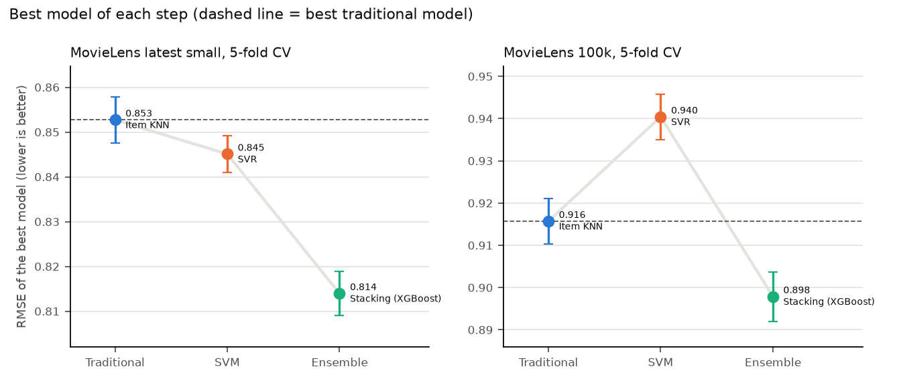

This repository contains all code, all raw results (about 6,800 runs) and all figures of the study.

**Author:** Elif Hüsna Turkay · Independent study supervised by Dr. Hyuk Cho, Department of Computer Science, Sam Houston State University

## Key findings

| | Best co-clustering | Best Funk SVD | Item-based KNN | SVR | Stacking (XGBoost) | Best deep learning | Best transformer |
|---|---|---|---|---|---|---|---|
| latest-small (5-fold) | C3, 10 × 5: 0.885 | 0.875 | 0.853 | 0.845 | **0.814** | NCF + MLP: 0.841 | HF BERT: 0.849 |
| ml-100k (5-fold) | C4, 50 × 2: 0.941 | 0.930 | 0.916 | 0.940 | **0.898** | NCF + MLP: 0.911 | HF BERT: 0.941 |
| ml-20m (random 80/20) | C4, 50 × 50: 0.837 | 0.786 | 0.785 | 0.856 | **0.769** | NCF + MLP: 0.793 | own: 0.803 |

**Single models**

- The six co-clustering bases rank very differently on small and large data. C6 (MSSRCC residue 2, Cho et al. 2004), the basis with the most parameters, is the worst on MovieLens latest-small and 100k and the best on MovieLens 20M at 2 × 2 and 3 × 3.
- The ranking follows **training ratings per learned parameter**: C6 has 2.6 per parameter on latest-small and 32 on 20M. Bases with fewer parameters can use much larger grids without overfitting.
- With basis and grid size chosen together, co-clustering comes within 0.011 RMSE of a tuned Funk SVD on the small datasets, and 0.051 behind on 20M.
- Funk SVD beats truncated SVD in all 60 comparisons (5 protocols × 3 datasets × 4 values of K). The best K grows with the data, from about 15 to 50–100.
- On the small datasets an item-based KNN beats every SVD and co-clustering setup under random splits, but loses to Funk SVD when each user's newest ratings are held out.

**SVR**

- The SVR beats the traditional models only on latest-small. On 20M we could only run an approximation of it (Nystroem, 500,000 ratings), and there it is worse than every traditional model.
- **The usual RBF SVR is slow, and a kernel approximation fixes this.** Nystroem with 1,000 components and a linear SVR trains 30 to 35 times faster on the small datasets (about 3 s against 90 to 98 s) and is only 0.003 to 0.005 worse in RMSE. Prediction goes from about 38 s to under 1 s. Nystroem is better than random Fourier features (RBF Sampler) with the same number of components.
- **The rating scale does not explain why KNN beats the SVR on ml-100k.** When we round latest-small to whole stars like ml-100k, the SVR still beats KNN on every split, by about the same margin.

**Ensembles, deep learning and transformers**

- **Combining the models works best, on all three datasets.** Stacking Funk SVD, co-clustering, KNN and the SVR with an XGBoost meta model gives 0.814 on latest-small, 0.898 on ml-100k (5-fold) and 0.769 on 20M (random 80/20). It is better than every other model in every split.
- Random Forest, XGBoost and CatBoost on the SVR features are about as good as the SVR. AdaBoost is the weakest ensemble.
- **Deep learning and transformers do not beat stacking.** The best network (NCF + MLP) is 0.027, 0.014 and 0.024 behind stacking on the three datasets. GRU and LSTM over each user's last 20 ratings are about as good as NCF + MLP on latest-small and worse on ml-100k. Our two small transformers are close to KNN on latest-small and worse than KNN on ml-100k and 20M.
- Temporal splits are harder for every model, but the ranking of the models stays almost the same. The sequence models (GRU, LSTM, transformers) use the order of the ratings, but on the temporal splits they are still worse than Funk SVD.

## What we did

1. **Datasets.** MovieLens latest-small and MovieLens 20M, the two datasets of a recent MovieLens benchmark (Khan et al., 2025), and MovieLens 100k as a third.
2. **One split module.** Every model is run under five protocols: random 80/20, per-user temporal 80/20, 5-fold CV, leave-last-one-out and leave-random-one-out. All scripts take their split from one module and record a fingerprint of the test set, so any two numbers in this repository can be checked for being measured on the same ratings.
3. **Six co-clustering bases.** All six bases of Banerjee et al. (2007) in one implementation, checked against their matrix forms ‖A − RRᵀACCᵀ‖² (C2) and ‖(I − RRᵀ)A(I − CCᵀ)‖² (C6). Each basis on a 9 × 9 grid of user and item cluster counts from 1 to 50 (5-fold CV on the small datasets, K = L on 20M), then each basis at its best size on all protocols.
4. **Two kinds of SVD.** Truncated SVD (SciPy `svds` on baseline residuals) and Funk SVD (our own implementation, identical to Surprise's `SVD` to 1e-15) for K = 0 to 100, on all protocols, plus Funk SVD with different regularization, epochs and learning rates.
5. **KNN.** Surprise `KNNBaseline`, item based, pearson_baseline similarity, k = 40. On 20M Surprise does not fit in memory, so we wrote our own version (`own_knn.py`). It computes one row of the similarity matrix at a time. On the two small datasets it gives the same predictions as Surprise (largest difference 1.3e-15).
6. **A Decision Tree baseline** with label-encoded user and movie IDs plus genres, as a reference.
7. **SVR.** An RBF support vector regression (scikit-learn `SVR`, C = 0.3, ε = 0.3, chosen on a validation part of the latest-small train set) on 26–27 features made from the train ratings: user and movie means, counts and spreads, the movie's genres and the user's taste for these genres. The features of each training rating are computed from the other 4/5 of the train set, so a rating never appears in its own features. Random 80/20, temporal 80/20 and 5-fold CV on the two small datasets. On 20M the exact RBF SVR is too slow. There we approximate the RBF kernel with Nystroem (1,000 components) and train a linear SVR on 500,000 random train ratings, with the same C, ε and γ. On latest-small this approximation gives 0.8475 and the exact SVR 0.8442.
8. **Stacking.** Funk SVD, the best co-clustering basis, KNN and SVR are combined by a meta model: a linear regression, and XGBoost on the four predictions plus the features. The meta model learns only from out-of-fold predictions (5 folds inside the train set), so it never sees a prediction made on a rating the base model was trained on. Same splits as the SVR, plus random and temporal 80/20 on 20M.
9. **Bagging and boosting.** Random Forest, AdaBoost, XGBoost and CatBoost on the same features as the SVR (not on the predictions). On 20M each Random Forest tree sees 800,000 ratings and AdaBoost a random 2 million, else they take too long.
10. **Deep learning.** NCF (He et al., 2017) with user and movie embeddings, an MLP on the SVR features, and a hybrid of both, in PyTorch. Adam, early stopping on 10% of the train set, seed 42. Then GRU and LSTM (2 layers, 64 units) over the user's last 20 train ratings, with the same input as the transformers below, 3 seeds.
11. **Transformers.** For each rating, the input is the user's last 20 train ratings before it and the target movie with a masked rating. This goes through a small encoder (2 layers, 4 heads, d = 64), and the output of the target token plus a user embedding gives the rating. We tried two encoders of the same size: our own in plain PyTorch (BST style, Chen et al., 2019) and a Hugging Face `BertModel` (random start). A test rating only sees train ratings with an earlier time, and the code checks this. 3 seeds on the small datasets, 1 seed on 20M.
12. **Fast SVR.** The usual RBF SVR against `LinearSVR`, `RBFSampler` + `LinearSVR` and `Nystroem` + `LinearSVR` (100, 300, 1,000 and 3,000 components), with the same features, C, ε and γ. RMSE on all splits of the two small datasets. Training and prediction time on the random split, on one core, the median of three runs with nothing else running.
13. **Rating scale.** Latest-small rounded to whole stars (half up: 0.5 → 1, 1.5 → 2, ...) after the split, then Funk SVD, KNN and the SVR again, to see if the scale explains the different results on latest-small and ml-100k.

## Repository layout

```
code/
  common_split.py    datasets, the five split protocols, test-set fingerprint
  own_models.py      Funk SVD (matches surprise.SVD) and sparse co-clustering
  bases.py           the six co-clustering bases C1..C6 in one class
  eval_protocols.py  one dataset x one model x one protocol -> results/eval.jsonl
  run_protocols.py   runs every model and protocol, prints the tables
  k_sweep.py         truncated SVD and Funk SVD for K = 0..100
  svd_full.py        both SVDs on all protocols; Funk SVD hyperparameters
  run_bases.py       six bases: 3 x 3 on all protocols, K x L grid, best cells
  plot_k.py, plot_svd_full.py, plot_bases.py   figures and tables
  features.py        the SVR features, computed from train ratings only
  own_knn.py         item-based KNN, the same as surprise.KNNBaseline, fits in memory on 20M
  base_preds.py      Funk SVD, co-clustering, KNN and SVR: out-of-fold and test predictions
  stack.py           stacking on those predictions, bagging and boosting on the features
  dl.py              NCF, MLP and hybrid, on the same splits and features
  bst.py             the two transformers (own encoder and Hugging Face BertModel)
  rnn.py             GRU and LSTM, the same input as bst.py
  svr_speed.py       the usual SVR against LinearSVR, RBFSampler and Nystroem
  plot_svr_speed.py  figure and tables for svr_speed.py
  quantize.py        latest-small rounded to whole stars, Funk SVD, KNN and SVR again
  plot_ensemble.py   figures and tables for SVR, ensembles, deep learning and transformers
scripts/
  download_data.py   fetches the datasets from GroupLens
results/
  *.jsonl            one JSON line per run (dataset, model, protocol, fold, RMSE, MAE, R², fingerprint)
  figures/           all figures
```

## Reproducing the results

```bash
pip install -r requirements.txt
python3 scripts/download_data.py          # add --20m for MovieLens 20M (about 190 MB)
cd code

python3 run_bases.py protocols mlsmall    # six bases at 3 x 3, all protocols (minutes)
python3 run_bases.py grid mlsmall kfold   # six bases x 81 sizes x 5 folds (about an hour)
python3 k_sweep.py mlsmall tsvd kfold     # truncated SVD, K = 0..100 (seconds)
python3 k_sweep.py mlsmall funk kfold     # Funk SVD, K = 0..100 (about a minute)
python3 svd_full.py protocols mlsmall
python3 run_protocols.py mlsmall          # SVD, KNN, Decision Tree, 3 x 3 co-clustering
python3 plot_bases.py && python3 plot_k.py && python3 plot_svd_full.py

python3 base_preds.py mlsmall random      # Funk SVD, co-clustering, KNN, SVR (about 10 minutes)
python3 stack.py mlsmall random           # stacking, bagging, boosting (minutes)
python3 dl.py mlsmall random              # NCF, MLP, hybrid (minutes)
python3 bst.py mlsmall random bst 42      # own transformer, seed 42 ("bert" for the HF encoder)
python3 bst.py mlsmall kfold 0 bert 42    # 5-fold CV: give the fold (0..4) before the model
python3 rnn.py mlsmall random gru 42      # GRU (or lstm), same arguments as bst.py
python3 svr_speed.py mlsmall random       # fast SVR versions (needs base_preds.py first)
python3 quantize.py random                # latest-small with whole stars
python3 base_preds.py mlsmall kfold 0     # base_preds, stack and dl take the fold the same way
python3 plot_ensemble.py
```

On 20M we ran only `random` and `temporal`. On a laptop `base_preds.py` takes about 1.5 hours per split (mostly the 50 × 50 co-clustering), `stack.py` about 30 minutes and `dl.py` about 20 minutes. One transformer run takes 3 to 14 hours on a GPU.

Replace `mlsmall` with `ml100k` or `ml20m` for the other datasets. Runs on 20M are slow (one 50 × 50 co-clustering run takes 10 to 30 minutes) and need about 6 GB of memory. The scripts of the single-model study skip runs that are already in their results file, so a stopped job can be restarted. `stack.py`, `dl.py` and `bst.py` always add new lines.

**Checking the splits.** Every run stores a fingerprint of its test set (first 12 hex digits of a SHA-256 over the sorted test ratings). With seed 42 the random 80/20 split gives `1f1d4736e82d` on latest-small, `83f1413e4316` on ml-100k and `9372caa7a99e` on ml-20m. If you get the same fingerprints, you are scoring exactly the same ratings.

**Data versions.** The results use MovieLens latest-small as of September 2018 (100,836 ratings; `ratings.csv` md5 `325a6f09399d1c45671f187505e1a100`). GroupLens updates this dataset occasionally; `download_data.py` prints the md5 for comparison. The 20M results were produced with the Kaggle copy (`grouplens/movielens-20m-dataset`); the loader also reads the GroupLens zip.

**Environment.** Python 3.13, NumPy 2.3.4, SciPy 1.17.1, pandas 3.0.3, scikit-learn 1.8.0, Surprise 1.1.5, numba 0.67.0, matplotlib 3.11.2, XGBoost 3.4.1, CatBoost 1.2.10, PyTorch 2.14.0, Transformers 5.20.1. Seed 42 everywhere (the transformers also 43 and 44). Deep learning and transformer runs were made on an Apple M2 GPU. Two 20M transformer runs (HF BERT random, own transformer temporal) were made on a Colab T4 GPU with the same code and the same split fingerprints. GPU runs are not fully deterministic, so the same seed can differ in the third decimal.

## More figures

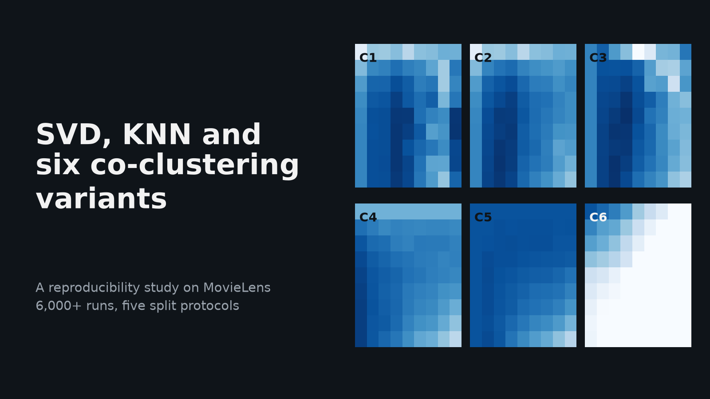

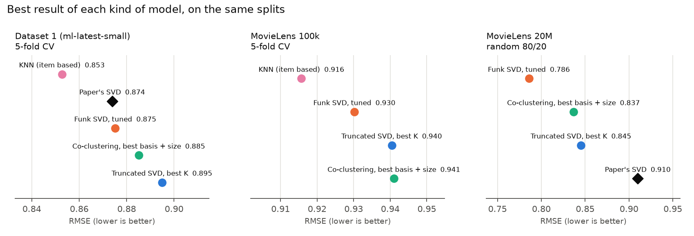

*Best result of each single model family (co-clustering, truncated SVD, Funk SVD, KNN) on the same splits.*

| | |
|---|---|
| 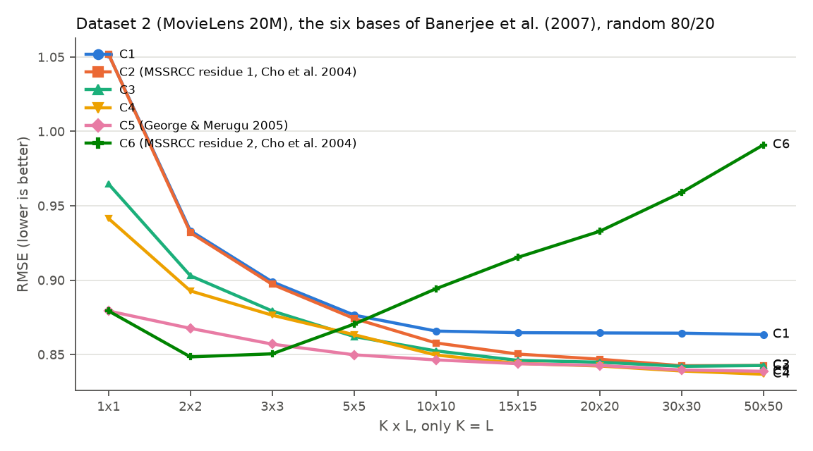 | 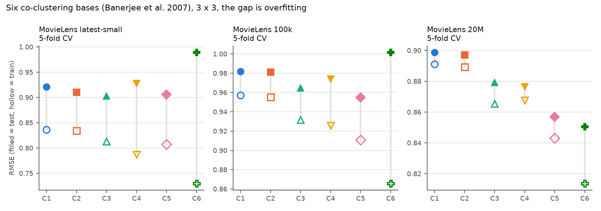 |
| Six bases on MovieLens 20M, K = L | Six bases at 3 × 3, train and test RMSE |
| 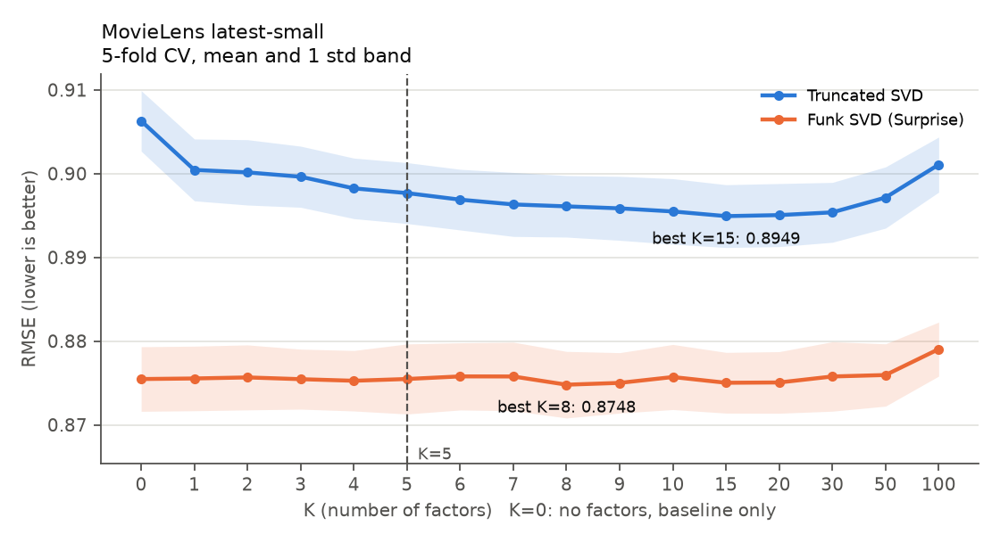 | 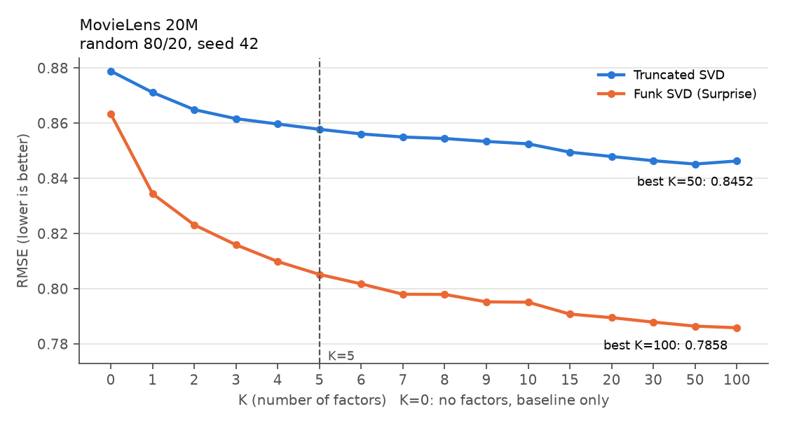 |
| K against RMSE, latest-small (5-fold) | K against RMSE, 20M |

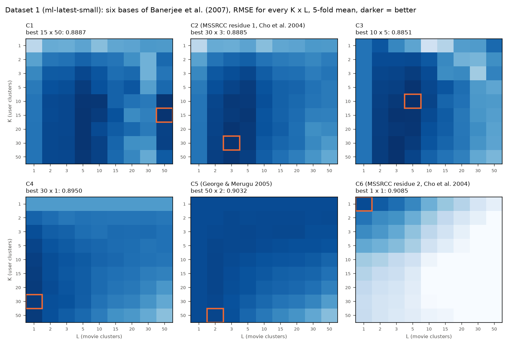

| | |
|---|---|
| 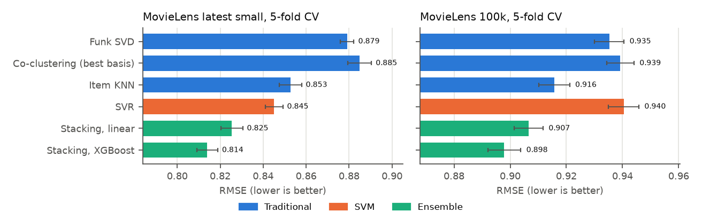 | 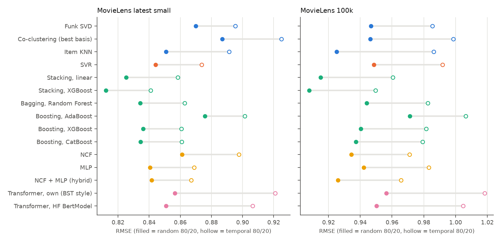 |
| All models after the single-model study (5-fold) | Random against temporal 80/20 |

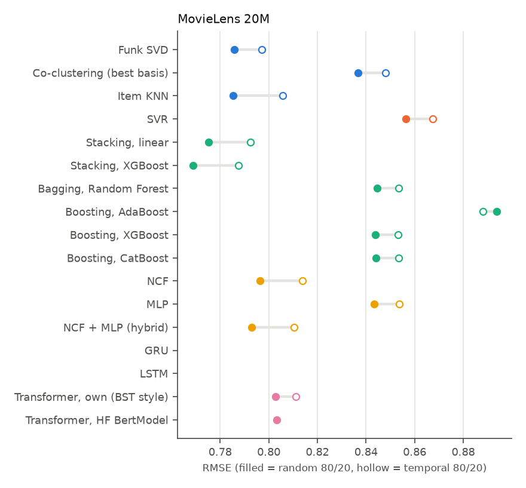

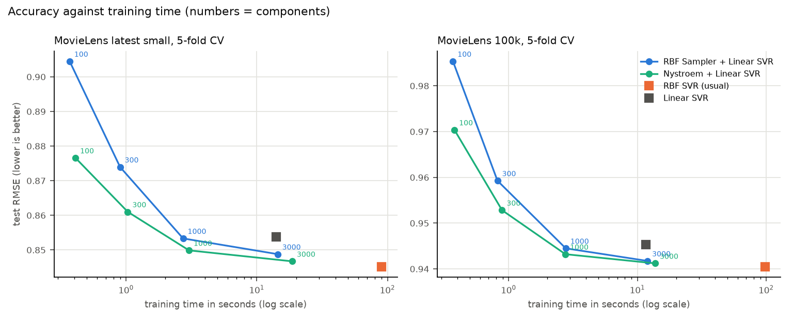

## Limitations

The full 81-cell grid was not run on 20M (K = L only). On 20M the steps after the single models were run on random and temporal 80/20 only, with one seed, and the HF BERT transformer on temporal 80/20 was not run. GRU and LSTM on 20M are not in this version yet. The settings of the SVR, the ensembles, the networks and the transformers were fixed by hand and not tuned. Deep learning uses one seed, small networks and at most 40 epochs. The "best configuration" values of the single-model study are selected on test results, so they are slightly optimistic for every model family.

## References

- Banerjee, A., Dhillon, I., Ghosh, J., Merugu, S., Modha, D. S. (2007). A generalized maximum entropy approach to Bregman co-clustering and matrix approximation. *JMLR* 8.
- Breiman, L. (2001). Random forests. *Machine Learning* 45(1).
- Chang, C.-C., Lin, C.-J. (2011). LIBSVM: A library for support vector machines. *ACM TIST* 2(3).
- Chen, Q., Zhao, H., Li, W., Huang, P., Ou, W. (2019). Behavior sequence transformer for e-commerce recommendation in Alibaba. *DLP-KDD Workshop*.
- Chen, T., Guestrin, C. (2016). XGBoost: A scalable tree boosting system. *ACM KDD*.
- Cho, H., Dhillon, I. S., Guan, Y., Sra, S. (2004). Minimum sum-squared residue co-clustering of gene expression data. *SIAM SDM*.
- Cho, K., van Merriënboer, B., Gulcehre, C., Bahdanau, D., Bougares, F., Schwenk, H., Bengio, Y. (2014). Learning phrase representations using RNN encoder-decoder for statistical machine translation. *EMNLP*.
- Cortes, C., Vapnik, V. (1995). Support-vector networks. *Machine Learning* 20(3).
- Devlin, J., Chang, M.-W., Lee, K., Toutanova, K. (2019). BERT: Pre-training of deep bidirectional transformers for language understanding. *NAACL-HLT*.
- Drucker, H. (1997). Improving regressors using boosting techniques. *ICML*.
- Drucker, H., Burges, C. J. C., Kaufman, L., Smola, A., Vapnik, V. (1997). Support vector regression machines. *NIPS* 9.
- Fan, R.-E., Chang, K.-W., Hsieh, C.-J., Wang, X.-R., Lin, C.-J. (2008). LIBLINEAR: A library for large linear classification. *JMLR* 9.
- Ferrari Dacrema, M., Cremonesi, P., Jannach, D. (2019). Are we really making much progress? A worrying analysis of recent neural recommendation approaches. *ACM RecSys*.
- Freund, Y., Schapire, R. E. (1997). A decision-theoretic generalization of on-line learning and an application to boosting. *Journal of Computer and System Sciences* 55(1).
- George, T., Merugu, S. (2005). A scalable collaborative filtering framework based on co-clustering. *IEEE ICDM*.
- He, X., Liao, L., Zhang, H., Nie, L., Hu, X., Chua, T.-S. (2017). Neural collaborative filtering. *WWW*.
- Hochreiter, S., Schmidhuber, J. (1997). Long short-term memory. *Neural Computation* 9(8).
- Khan, H. U., Naz, A., Alarfaj, F. K., Almusallam, N. (2025). A transformer-based architecture for collaborative filtering modeling in personalized recommender systems. *Scientific Reports* 15, 24503.
- Prokhorenkova, L., Gusev, G., Vorobev, A., Dorogush, A. V., Gulin, A. (2018). CatBoost: Unbiased boosting with categorical features. *NeurIPS*.
- Rahimi, A., Recht, B. (2007). Random features for large-scale kernel machines. *NIPS* 20.
- Williams, C. K. I., Seeger, M. (2001). Using the Nyström method to speed up kernel machines. *NIPS* 13.
- Wolf, T., et al. (2020). Transformers: State-of-the-art natural language processing. *EMNLP: System Demonstrations*.
- Wolpert, D. H. (1992). Stacked generalization. *Neural Networks* 5(2).
- Yang, T., Li, Y.-F., Mahdavi, M., Jin, R., Zhou, Z.-H. (2012). Nyström method vs random Fourier features: A theoretical and empirical comparison. *NIPS* 25.

## Acknowledgements

This work was carried out as an independent study at Sam Houston State University under the supervision of Dr. Hyuk Cho.

## License

Code: MIT (see `LICENSE`). MovieLens data is not included; it is provided by GroupLens under its own terms.
